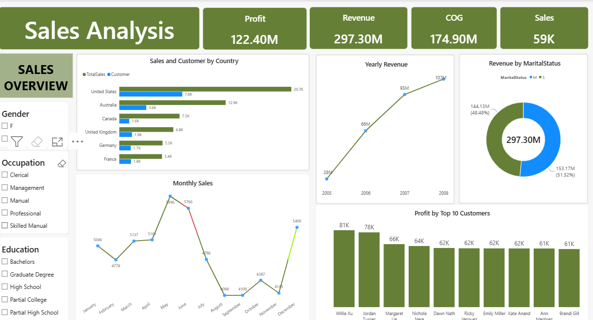
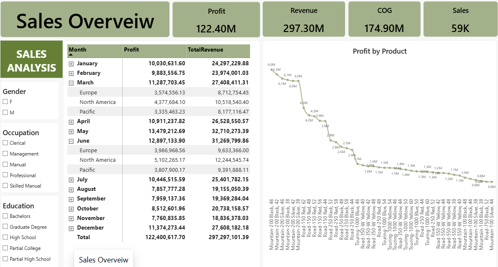

# Sales Analysis And Sales Overveiw
An interative Sales Analysis and sales Overveiw dashboard created for a fictional Retail store.

## Project Overview
- Jane wants to understand the store's sales performance, profitability, and revenue between 2005 and 2010 retail store that sells different products to customers across various geographical locations and territories
- The main objective is to develop an interactive sales analysis dashboard that provides management with a clear overview of business performance.
- Evaluate sales performance: Analyze total sales, profit, quantity sold and order trends between 2005 and 2010.

## From Data to Dashboard

The project started with a structured dataset, followed by data preparation, analysis, dashboard planning, and final visualization in Excel.

### Sales Analysis Dashboard

### Sales Analysis Overview

## Dashboard Features

- Profit, Revenue,Sales and Cost of Goods
- Fiscal Year Slicer
- Profit Analysis by Month
- Yearly Revenue
- Interative Pivotcharts
- Dynamic KPI cards

## Files Included

| File | Description |
|---|---|
| `Sales Analysis & Overveiw.pbix` | Completed Power BI dashboard |
| `Sales_Analysis.png` | Preview of the Sales Analysis dashboard |
| `Sales_Overveiw.png` |  Preview of the Sales Overveiw dashboard |
| `README.md` | Project documentation |

## Tools and Skills

- Microsoft Excel
- Power BI
- DAX (Data Analysis Expressions)
- PivotTables
- PivotCharts
- Slicers
- Data analysis
- Dashboard design
- Data visualization
